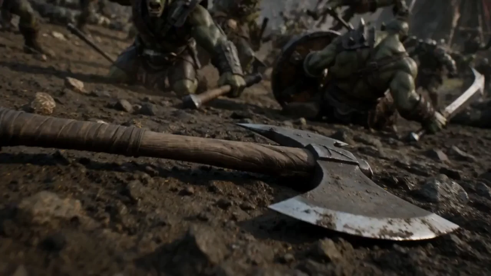

# C001 · 冻结战场中的穿行摄影机

作者：Stanzin Raghu
来源：https://x.com/WordTrafficker/status/2077616872577712171

以下原词逐字保留自案例库，不以编辑解读替代。原文中的模型名、参数和效果宣称为作者当时的写法，未在本轮生成验证。

- [完整库内原词 1](C001-prompt-1.txt)（575 字符）

此图为案例预览，不代替完整视频核验。

## 媒体来源
- [video 1](https://x.com/WordTrafficker/status/2077616872577712171)
- [video 2](https://wchao6891.github.io/PromptDirector-Curated/previews/cases-d8fbcd1a05ba01c7f2c8/media/07a0a7597efcfcc1c8be.webp)

第三方来源精选 · 权利归原作者 · 授权未核验。
