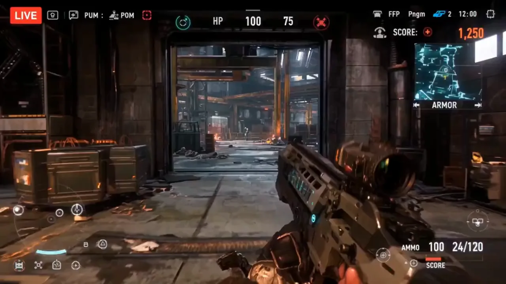

# C219 · 瞄准模式切换及需要纠正的计数

作者：Ai Girllie
来源：https://x.com/Inshrah_ali_/status/2104256509077328333

以下原词逐字保留自案例库，不以编辑解读替代。原文中的模型名、参数和效果宣称为作者当时的写法，未在本轮生成验证。

- [完整库内原词 1](C219-prompt-1.txt)（3761 字符）

此图为案例预览，不代替完整视频核验。

## 媒体来源
- [video 1](https://x.com/Inshrah_ali_/status/2104256509077328333)
- [video 2](https://wchao6891.github.io/PromptDirector-Curated/previews/cases-15e09c79753fcb0bea4c/media/8e3ace4996b683a7db5e.webp)

第三方来源精选 · 权利归原作者 · 授权未核验。
