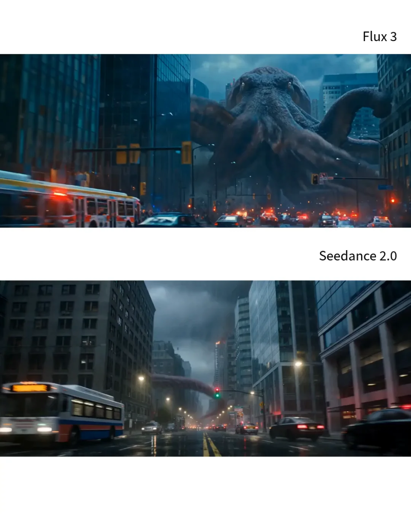

# C028 · 城市建筑作为怪物的参照物

作者：Jin.B
来源：https://x.com/opener_ai/status/2081761933305520365

以下原词逐字保留自案例库，不以编辑解读替代。原文中的模型名、参数和效果宣称为作者当时的写法，未在本轮生成验证。

- [完整库内原词 1](C028-prompt-1.txt)（2525 字符）

此图为案例预览，不代替完整视频核验。

## 媒体来源
- [video 1](https://x.com/opener_ai/status/2081761933305520365)
- [video 2](https://wchao6891.github.io/PromptDirector-Curated/previews/cases-188037bfd925a5121795/media/bdfea7584716fbd43f40.webp)

第三方来源精选 · 权利归原作者 · 授权未核验。
